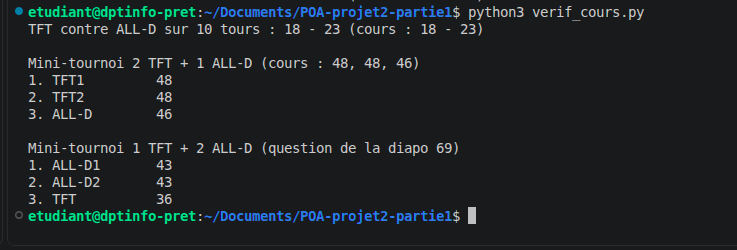
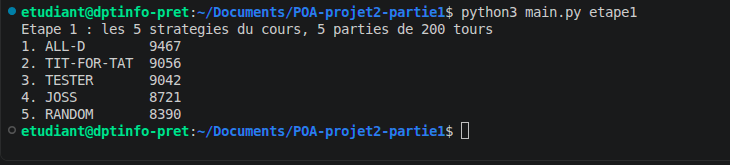
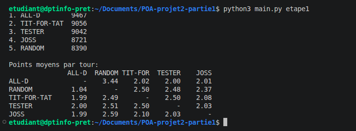
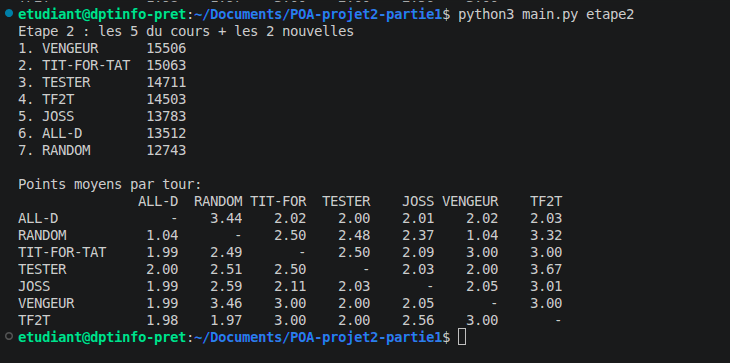

# Journal de bord — KABOURI OUZENNOU Jaouad

## Vendredi 13/11

### Je pose le protocole avant de coder

Je reprends le tournoi du cours (diapo 63) tel quel pour commencer :
5 stratégies (ALL-D, RANDOM, TIT-FOR-TAT, TESTER, JOSS), chacune affronte
chaque autre sur 5 parties de 200 tours, et on additionne les points.
Gains du cours : 3/3 si les deux coopèrent, 2/2 si les deux trahissent,
5 pour celui qui trahit et 0 pour celui qui se fait avoir.

Je me suis demandé si une stratégie devait aussi jouer contre elle-même.
Au début je voulais l'inclure, parce que j'avais lu qu'Axelrod le faisait..
Mais dans le mini-tournoi de la diapo 68 il y a un tiret sur la diagonale,
donc dans le cours elles ne jouent pas contre elles-mêmes. Je fais pareil,
comme ça je pourrai comparer mes chiffres à ceux des diapos.

Je fais ça en Python sans bibliothèque. Je fixe la graine aléatoire à 42 :
RANDOM et JOSS tirent au hasard, donc sans graine le classement bougerait
à chaque lancement et je ne pourrais rien comparer.
Pour les stratégies je pars sur une fonction par stratégie : elle reçoit
ses coups passés et ceux de l'adversaire, et elle renvoie "C" ou "D".
Elle ne voit pas ce que l'autre joue au tour en cours.

1ere étape: vérifier le moteur avec la diapo 67 (TFT contre ALL-D
sur 10 tours, ça doit donner 18 contre 23) avant de lancer le vrai tournoi.

### Le moteur: une seule partie d'abord

Avant de faire le tournoi, je commence par une seule partie entre deux stratégies. 
Une stratégie c'est juste une fonction: elle reçoit
ses coups passés et ceux de l'adversaire, et elle renvoie "C" ou "D".
Le moteur appelle les deux fonctions avant d'ajouter les coups aux
historiques, comme ça aucune ne voit le coup de l'autre au tour en cours.

Pour vérifier j'ai codé que ALL-D et TIT-FOR-TAT, et j'ai refait la
diapo 67 (10 tours). J'obtiens 18 pour TFT et 23 pour ALL-D, comme le cours.

### Le tournoi tous contre tous

Chaque paire de stratégies joue une fois
(5 parties de 200 tours par défaut), jamais contre elle-même, et on
additionne les points de chacune.

Vérification avec la diapo 68 (deux TFT et un ALL-D, 10 tours): je retombe sur 48, 48 et 46 toujours comme dans le cours.   

J'ai aussi essayé la question de la diapo 69, un seul TFT contre deux ALL-D.
Là c'est ALL-D qui gagne (43 contre 36). Ça m'a un peu surpris au début, mais en fait c'est logique : le TFT n'a personne avec qui coopérer. Il se fait avoir au premier tour par les deux et ne rattrape jamais son retard. Donc TFT ne gagne pas tout seul, ça dépend de qui est en face. À garder en tête pour le vrai tournoi.

## Samedi 14/11

### Les 5 stratégies du cours 
*ALL-D : trahit toujours. Devrait bien marcher contre ceux qui se laissent
  faire (RANDOM), mais bloquée à 2 points par tour contre ceux qui ripostent.
*RANDOM : C ou D à pile ou face. Devrait se faire exploiter par ALL-D.
*TIT-FOR-TAT : C puis recopie l'autre. Devrait bien jouer contre ceux qui coopèrent et limiter la casse contre
  ALL-D.
*TESTER : D au début pour voir. Si l'autre riposte elle passe en TFT, sinon
  elle répète C, C, D. Devrait profiter de ceux qui ne punissent pas.
*JOSS : TFT qui trahit une fois sur dix à la place d'un C. Risque de casser la coopération.

### Premier lancement
TFT ne gagne pas, c'est ALL-D.

Le classement ne montrait rien d'anormal, mais en relisant mon code avec la diapo 64
j'ai vu que TESTER ne faisait que la moitié de la règle : D puis TFT, sans
le « sinon répète C, C, D ». J'ai donc push la v2.

Ça change presque rien: TESTER passe de 9040 à 9042. Logique en fait,
ici tout le monde riposte tout de suite, donc TESTER n'a personne à exploiter.

### Pourquoi TFT ne gagne pas
Tableau des points moyens par tour dans chaque duel :

TFT n'arrive à 3 points par tour avec personne. Contre TESTER (2,50) ils se
renvoient la trahison un tour sur deux, comme l'écho de la diapo 72. Contre
JOSS (2,08) ça finit en D/D. ALL-D fait 2 partout et 3,44 contre RANDOM,
et ça suffit.

Par rapport à 1980 :
-TFT est la seule "gentille" ici, elle n'a personne avec qui coopérer.
-Pas de match contre soi-même: avec, TFT prendrait 3000 points et ALL-D
  2000, donc 12056 contre 11467, et TFT gagnerait.
-D/D rapporte 2, presque autant que C/C. À tester à l'étape 3.

## Étape 2 : deux nouvelles stratégies

### VENGEUR
Coopère toujours, mais à la première trahison de l'autre il trahit jusqu'à
la fin. Je l'ai choisie car dans le cours (71), il dit que les
stratégies qui classaient l'adversaire « traître pour toujours » ont perdu
parce qu'elles ne pardonnaient pas. Je veux voir si c'est vrai chez moi.
1) Devrait bien jouer contre TFT et TF2T : personne ne trahit en premier,
  donc 3 points par tour. Et contre RANDOM : dès le premier D il devient
  un ALL-D et l'exploite.
2) Devrait mal jouer contre JOSS et TESTER : une seule trahison et c'est la
  guerre jusqu'au bout, à 2 points par tour.

### TF2T (tit-for-two-tats)
Coopère, et ne trahit que si l'autre vient de trahir deux fois de suite.
Axelrod a écrit qu'elle aurait gagné en 1980 si on l'avait soumise. 
Je l'ai choisie parce qu'à l'étape 1 TFT se fait piéger
par l'écho contre TESTER et JOSS: je veux voir si pardonner une fois
règle le problème.

1) Devrait bien jouer contre TFT et VENGEUR, et mieux que TFT contre JOSS.
2) Devrait mal jouer contre RANDOM (il trahit une fois sur deux sans être
  puni à chaque fois) et devrait perdre deux tours au lieu d'un contre ALL-D.
3) TESTER ne trahit jamais deux fois de suite (D, C, C, D...), donc TF2T risque de ne jamais le punir.

Mon pronostic pour le classement : ALL-D gagne encore, suivi de TF2T, TFT, VENGEUR, TESTER, JOSS, RANDOM.

### Résultat de l'étape 2

J'avais mis ALL-D premier, il finit 6e.. VENGEUR,
que je voyais 4e, gagne. TF2T, que je voyais 2e, est 4e.

* ALL-D ne joue pas moins bien qu'à l'étape 1: toujours 2 points par tour
  partout et 3,44 contre RANDOM. Ce sont les autres qui ont monté, parce que
  VENGEUR, TFT et TF2T ont 3 points entre eux. C'est en plus dans la diapo 69:
  les gentilles prospèrent quand il y en a plusieurs. J'avais pas pris en compte le changement de la population.
* VENGEUR passe devant TFT grâce à RANDOM (3,46 contre 2,49): au premier D
  il devient un ALL-D et l'exploite. La diapo 71 dit que ne pas pardonner
  fait perdre, mais ici ça paye, parce que ceux à qui il ne pardonne pas
  (JOSS, TESTER, RANDOM) ne méritaient pas vraiment d'être pardonnés.
* TF2T pardonne trop: TESTER l'exploite (3,67 pour lui, 2,00 pour elle),
  RANDOM aussi. Mon doute sur TESTER était bon. Elle fait quand même mieux
  que TFT contre JOSS (2,56 contre 2,09), donc pardonner casse bien l'écho.
* TESTER monte 3e: à l'étape 1 il n'avait personne à exploiter, maintenant
  il a TF2T.

Par rapport à l'étape 1: ALL-D 1er→ 6e, TFT reste 2e. Le classement
dépend surtout de qui est dans la population.

## Étape 3 : deux modifications du tournoi
Je change une seule chose à la fois pour pouvoir comparer.

### Modification 1 : autres gains (D/D passe de 2 à 1)
Je choisis celle là car à l'étape 1 j'avais noté que D/D rapporte 2, presque autant que
C/C, et que ça aidait ALL-D. Je passe D/D à 1, les autres gains ne bougent
pas. Ça reste un dilemme (5 > 3 > 1 > 0), et c'est la matrice du vrai
tournoi d'Axelrod.

Ma prédiction:
1) ALL-D reste  parmi les deux derniers: il passe presque tout son temps en D/D,
  donc il perd un point par tour partout.
2) VENGEUR n'est plus premier : dès qu'on le trahit une fois il trahit
  jusqu'à la fin, donc lui aussi passe beaucoup de temps en D/D.
3) TF2T remonte parce qu'elle trahit le moins.
Premier: Tester ou TFT2.

### Modification 2 : bruit (5 %)
Pourquoi: Dans la diapo 72, une seule erreur suffit à lancer un écho entre deux TFT. 
J'ai maintenant une stratégie qui ne pardonne jamais (VENGEUR) et une
qui pardonne (TF2T), je veux voir laquelle tient. À chaque tour, le coup
de chaque joueur est inversé avec une probabilité de 5 %. 

Mes Prédictions:
1) VENGEUR descend 6e ou 7e: avec une erreur de temps en temps, il finit en
  guerre contre tout le monde, même contre TFT et TF2T.
2) ALL-D finit 1er ou 2e: le bruit ne le pénalise presque pas.
3) TF2T devrait passer devant TFT: elle pardonne une erreur, TFT part en écho directement.