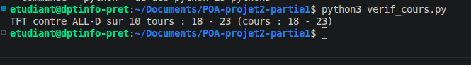

# Journal de bord — KABOURI OUZENNOU Jaouad

## Vendredi 13/11

### Je pose le protocole avant de coder

Je reprends le tournoi du cours (diapo 63) tel quel pour commencer :
5 stratégies (ALL-D, RANDOM, TIT-FOR-TAT, TESTER, JOSS), chacune affronte
chaque autre sur 5 parties de 200 tours, et on additionne les points.
Gains du cours : 3/3 si les deux coopèrent, 2/2 si les deux trahissent,
5 pour celui qui trahit et 0 pour celui qui se fait avoir.

Je me suis demandé si une stratégie devait aussi jouer contre elle-même.
Au début je voulais l'inclure, parce que j'avais lu qu'Axelrod le faisait..
Mais dans le mini-tournoi de la diapo 68 il y a un tiret sur la diagonale,
donc dans le cours elles ne jouent pas contre elles-mêmes. Je fais pareil,
comme ça je pourrai comparer mes chiffres à ceux des diapos.

Je fais ça en Python sans bibliothèque. Je fixe la graine aléatoire à 42 :
RANDOM et JOSS tirent au hasard, donc sans graine le classement bougerait
à chaque lancement et je ne pourrais rien comparer.
Pour les stratégies je pars sur une fonction par stratégie : elle reçoit
ses coups passés et ceux de l'adversaire, et elle renvoie "C" ou "D".
Elle ne voit pas ce que l'autre joue au tour en cours.

1ere étape: vérifier le moteur avec la diapo 67 (TFT contre ALL-D
sur 10 tours, ça doit donner 18 contre 23) avant de lancer le vrai tournoi.

### Le moteur: une seule partie d'abord

Avant de faire le tournoi, je commence par une seule partie entre deux stratégies. 
Une stratégie c'est juste une fonction: elle reçoit
ses coups passés et ceux de l'adversaire, et elle renvoie "C" ou "D".
Le moteur appelle les deux fonctions avant d'ajouter les coups aux
historiques, comme ça aucune ne voit le coup de l'autre au tour en cours.

Pour vérifier j'ai codé que ALL-D et TIT-FOR-TAT, et j'ai refait la
diapo 67 (10 tours). J'obtiens 18 pour TFT et 23 pour ALL-D, comme le cours.

### Le tournoi tous contre tous

Chaque paire de stratégies joue une fois
(5 parties de 200 tours par défaut), jamais contre elle-même, et on
additionne les points de chacune.

Vérification avec la diapo 68 (deux TFT et un ALL-D, 10 tours): je retombe sur 48, 48 et 46 toujours comme dans le cours.

J'ai aussi essayé la question de la diapo 69, un seul TFT contre deux ALL-D.
Là c'est ALL-D qui gagne (43 contre 36). Ça m'a un peu surpris au début, mais en fait c'est logique : le TFT n'a personne avec qui coopérer. Il se fait avoir au premier tour par les deux et ne rattrape jamais son retard. Donc TFT ne gagne pas tout seul, ça dépend de qui est en face. À garder en tête pour le vrai tournoi.

